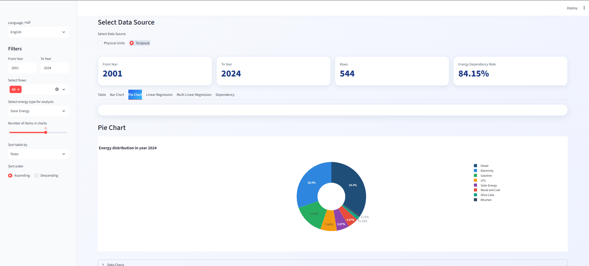

# Energy Balance Dashboard — Palestine (2001–2024)

An interactive, bilingual (Arabic / English) dashboard for exploring Palestine's national energy balance, built during a data analysis internship at the **Palestinian Central Bureau of Statistics (PCBS)**.

**Live demo:** _coming soon_



## What it does

- **Two data sources:** switch between physical units and terajoules (TJ).
- **Filters:** year range, energy flows (production, imports, exports, stock changes, consumption by sector…) and energy type.
- **Table view:** choose visible columns, sort, and download the filtered table as Excel.
- **Charts:** totals by energy type (bar), energy mix for the latest year (pie).
- **Trend and forecast:** linear regression on the yearly totals of the selected energy type, with R² and a 5-year forecast.
- **Trends by flow:** a separate linear trend fitted for each energy flow, actual vs. predicted.
- **Energy dependency rate** (TJ data): net imports ÷ total energy supply × 100, with its components.
- **Arabic / English interface:** labels, energy types and flow names are all translated.

## Data

Energy balance tables published by PCBS for 2001–2024, in two files:

| File | Content |
| --- | --- |
| `physical.xlsx` | Energy balance in physical units |
| `terajoul.xlsx` | Energy balance in terajoules |

The loader finds the header row on its own, standardizes flow and energy-type names, and converts PCBS notation (`-`, `..`, trailing minus signs) into numbers.

## Tech stack

Python · Streamlit · pandas · Plotly · scikit-learn · openpyxl

## Run it locally

```bash
pip install -r requirements.txt
streamlit run app.py
```

Then open `http://localhost:8501` in your browser.

## Team

Built by **Ali Khalil** and **Sameh** as part of the PCBS internship (March–July 2026).

Data source: [Palestinian Central Bureau of Statistics](https://www.pcbs.gov.ps).
